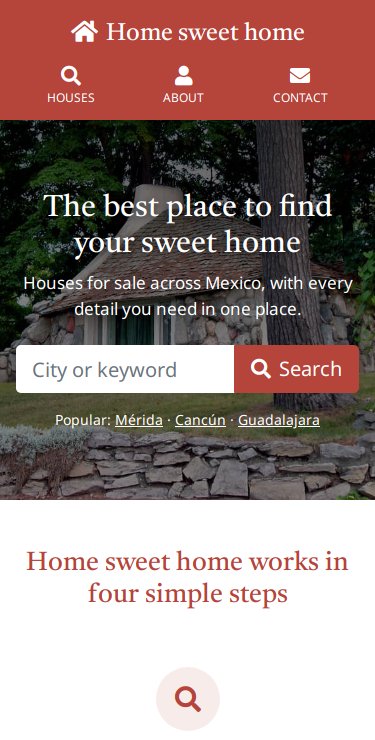
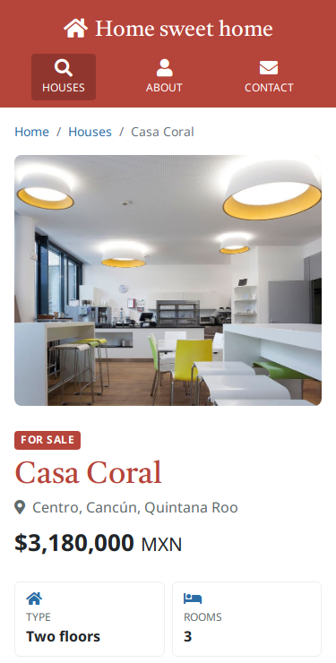
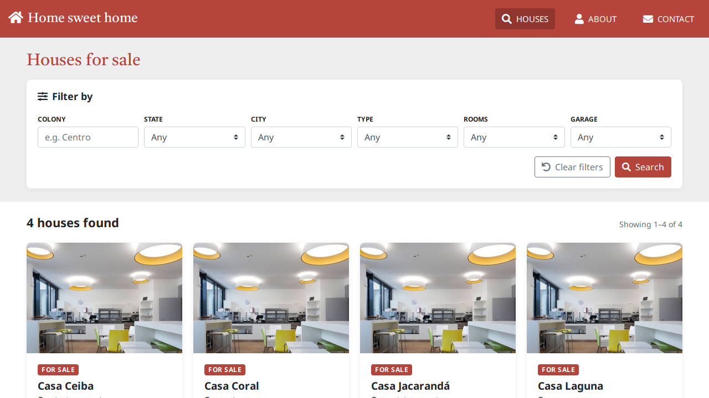

# 8 Capstone Project

> The project I'm going to build for the HTML & CSS Capstone Project is based on an online directory of schools. I just follow the given design of the website, but I personalise the content, instead of a directory of schools I built a real state agency web site.





## Built With

- HTML 5
- CSS 3
- Bootstrap 4.5
- Sass (SCSS)
- Font Awesome 5

## Live Demo

[Live Demo Link](https://vichuge.github.io/8-capstone-project/)

## Getting Started

- Clone or download this project on your computer
- Open `index.html` with your favorite browser

### Editing styles

Styles are written in SCSS (`assets/stylesheets/sass/`) and compiled to `assets/stylesheets/css/style.css`:

```bash
npx sass --no-source-map --style=expanded assets/stylesheets/sass/style.scss assets/stylesheets/css/style.css
npx stylelint "assets/stylesheets/css/style.css" --fix
```

### Linters

The project uses [Stylelint](https://stylelint.io/) and [Webhint](https://webhint.io/) (Microverse configs in `.stylelintrc.json` and `.hintrc`). They run on GitHub Actions for every pull request. To run them locally:

```bash
npm install --no-save stylelint@13.3.x stylelint-scss@3.17.x stylelint-config-standard@20.0.x stylelint-csstree-validator@1.x hint@7.x
npx stylelint "**/*.{css,scss}"
npx hint --telemetry=off .
```

## Author

👤 **Victor Pacheco**

- GitHub: [@vichuge](https://github.com/vichuge)
- LinkedIn: [LinkedIn](https://www.linkedin.com/in/victor-pacheco-7946aab2/)

## 🤝 Contributing

Contributions, issues, and feature requests are welcome.

Feel free to check the [issues page](https://github.com/vichuge/8-capstone-project/issues).

## Show your support

Give a ⭐️ if you like this project!

## 📝 License

This project is [Creative Commons Legal Code](https://github.com/vichuge/8-capstone-project/blob/main/LICENSE) licensed.
Artistic attribution for [Mathew Njuguna](https://www.behance.net/mathewnjuguna) and [Sam Achola](https://www.behance.net/aweSam)
